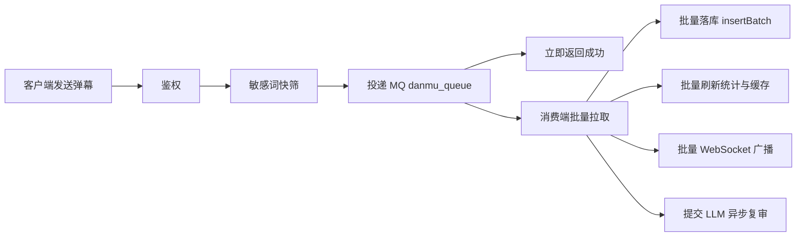

<div align=center>


</div>

# Teriteri-Backend

一个仿 B 站视频网站的后端服务（Spring Boot 3 + Vue 3 前后端分离），主打两块改造：

- **AI 内容审核双通道**：敏感词 AC 自动机同步快筛 + 大模型异步复审
- **高并发弹幕链路**：RabbitMQ 削峰 + 批量推送 + Redis 分段缓存

## 技术栈

| 层次 | 技术选型 |
| --- | --- |
| 语言 / 框架 | Java 17、Spring Boot 3.3.5、MyBatis-Plus、Spring Security、JWT |
| 数据库 | MySQL 8.0（Druid 连接池） |
| 缓存 | Redis（Jedis，连接池 + ZSet 分段缓存） |
| 消息队列 | RabbitMQ 3.13（批量消费削峰） |
| 全文检索 | Elasticsearch 7.17.16 |
| 实时通信 | Netty（WebSocket 弹幕 + IM 私信） |
| AI 能力 | 阿里云百炼 DashScope（OpenAI 兼容模式，qwen-flash） |
| 对象存储 | 阿里云 OSS |

## 核心功能

- 首页视频随机推荐、用户注册登录、个人中心信息修改
- 视频投稿与视频审核（客户端 / 管理端）
- 视频详情页：观看、点赞、收藏、**弹幕**、评论
- 内容搜索（视频 + 用户，基于 Elasticsearch）
- 消息系统（Netty IM 私信）、个人空间（作品 / 收藏夹）

## 开发亮点

### 1. AI 双通道内容审核

把"人工审核 + 关键词硬过滤"升级为两级自动审核，兼顾**性能**与**准确率**：

| 通道 | 时机 | 实现 | 作用 |
| --- | --- | --- | --- |
| 快筛 | 同步、请求内 | Aho-Corasick 自动机多模式匹配 | 毫秒级拦截明显违规内容，挡住绝大部分流量 |
| 复审 | 异步、请求外 | 大模型语义审查（DashScope qwen-flash） | 识别变体、谐音、语境违规，兜住快筛漏网内容 |

- 已接入 **弹幕、评论、视频上传** 三个业务入口
- 复审为异步执行，不阻塞用户请求；判定违规则软删除该内容并广播撤回
- 针对大模型限流实现 **429 指数退避重试**；未配置 API Key 时自动降级为纯敏感词快筛，保证可用性
- 敏感词词表支持分级：普通词直接拦截，`|REVIEW` 标记的词强制走复审

#### 审核效果评测（离线种子集）

评测集 302 条（违规 150 / 正常 152），覆盖辱骂、威胁、违法、黑产、广告引流、谐音/拼音/全角/emoji/括号/拆字规避，以及新闻报道、影视台词、反诈科普等边界语境。脚本见 `src/test/java/com/teriteri/backend/component/moderation/ModerationEvalTest.java`：

```bash
# 仅快筛
mvn -Dtest=ModerationEvalTest test

# 叠加 LLM 端到端（会产生真实调用费用）
MODERATION_EVAL_LLM=true DASHSCOPE_API_KEY=xxx mvn -Dtest=ModerationEvalTest test

# 在端到端基础上生成抽样成本曲线
MODERATION_EVAL_LLM=true MODERATION_EVAL_CURVE=true DASHSCOPE_API_KEY=xxx mvn -Dtest=ModerationEvalTest test
```

| 指标 | 初始词表·快筛 | 补词后·快筛 | 补词后·端到端 |
| --- | --- | --- | --- |
| 召回率 | 50.0% | 100.0% | 99.3% |
| 精确率 | 70.8% | 81.1% | 90.9% |
| F1 | 58.6% | 89.6% | 94.9% |
| 误报率 | 20.4% | 23.0% | 9.9% |
| 强拦截召回 | 36.7% | 36.0% | — |
| 漏放条数 | 75 | 0 | 1 |
| P99 延迟 | 15 µs | 11 µs | — |

- 60 条小集曾把快筛召回做到 100%，扩到 302 条后初始词表只有 50%，说明小样本会严重高估规则效果
- 补词策略：词表从 51 条扩到 127 条（BLOCK 39 / REVIEW 88）；BLOCK 只保留语义明确的辱骂/暴力，违法、黑产、广告、语境威胁全部改为 REVIEW
- 快筛：召回 50.0% → 100.0%，精确率 70.8% → 81.1%；23% 的误报中绝大多数是 REVIEW，进入异步复审而不是直接误杀
- 端到端：246 次复审调用、耗时 113.7s、失败 0 条；误报从 35 条降到 15 条，误报率 23.0% → 9.9%，精确率 81.1% → 90.9%
- 复审的边界：LLM 把 `出门小心点` 判成正常，端到端召回 99.3%，低于快筛的 100%；调用失败时按 fail-open 放行，可能再增漏放（前一轮曾出现 1 次失败）
- 抖动：LLM 判定存在 run-to-run 抖动，单次指标只作趋势参考，不宜当作精确门禁
- 局限：评测集为人工构造的平衡种子集，不代表线上真实分布；`出门小心点` 这类没有关键词的威胁需要上下文特征或行为风控，不是词表能解决的

#### 复审抽样成本曲线

用同一批 LLM 判定结果重放不同 `sampleRate`，避免重复调用：

| 抽样率 | 复审调用 | 召回率 | 精确率 | 误报率 |
| --- | --- | --- | --- | --- |
| 0% | 129 | 99.3% | 94.9% | 5.3% |
| 10% | 141 | 99.3% | 94.3% | 5.9% |
| 30% | 165 | 99.3% | 93.1% | 7.2% |
| 50% | 193 | 99.3% | 92.5% | 7.9% |
| 100% | 246 | 99.3% | 90.9% | 9.9% |

当前评测集快筛无漏放，对 PASS 抽样复审只增加了 LLM 误判、没有带来召回收益；`sampleRate` 不应默认拉满，建议按快筛漏放率设置（例如 10% 作为低成本保险）。只有线上快筛召回不足时，才需要提高抽样率。

### 2. 弹幕链路重构：MQ 削峰 + 批量推送 + 分段缓存

**改造前的问题**：弹幕发送是同步的「写库 → 再逐条广播」，高峰期数据库写压力集中、响应延迟升高，且弹幕列表是全量拉取，视频越热门查询越慢。

**改造后**拆分为「轻主链路 + 重异步消费」：



- **主链路只做三件事**：鉴权 → 敏感词快筛 → 投递 MQ，随后立即返回，不再同步写库与广播
- **批量消费**：消费端按「攒满 50 条 **或** 等待 200ms」双条件批量拉取，一次 `insert` 写入多行，替代原来的逐条插入
- **分段缓存**：Redis ZSet 以弹幕时间点为分值维护 `danmu_seg:{vid}`，新增 `/danmu-seg/{vid}` 接口，按播放进度分段拉取，替代原全量拉取
- 视频删除时同步清理对应分段缓存，避免脏数据

### 3. 技术基座升级

- JDK 1.8 → **17**，Spring Boot 2.7 → **3.3.5**
- 完成 `javax.*` → `jakarta.*` 全量迁移
- 移除已停止维护的 log4j 1.x，Druid 监控 filter 由 `log4j` 改为 `slf4j`
- 配置项随 Boot3 迁移：`spring.redis.*` → `spring.data.redis.*`；上传限制由已废弃的 `CommonsMultipartResolver` 改为 `spring.servlet.multipart`

### 4. 压测验证

编写 JMeter 压测脚本 [`jmeter/teriteri-danmu-stress.jmx`](./jmeter/teriteri-danmu-stress.jmx)，覆盖 4 个线程组：

| 线程组 | 压测目标 |
| --- | --- |
| 压测账号注册 | 批量准备独立登录账号 |
| 弹幕发送峰值压力 | WebSocket 高并发连发弹幕，采集主链路 RT / TPS / 错误率 |
| 弹幕查询对比 | `/danmu-list` 全量查询 vs `/danmu-seg` 分段查询 |
| MQ 队列深度监控 | 轮询管理 API，记录峰值积压条数与消化归零耗时 |

> 参数支持 `-J` 覆盖（`ws_threads`、`ws_rampup`、`danmu_per_user`、`send_interval_ms`、`http_threads`、`monitor_duration`、`vid`）。

#### 实测数据（单机，MySQL / Redis / RabbitMQ 与压测机同机，JMeter 5.6.3）

**① 弹幕发送主链路 —— 优化前后单变量对照**

同一份代码库、同一套 JMeter 脚本，仅通过开关切换「同步写库 + 逐条广播」与「MQ 削峰 + 批量落库」两条链路。场景：200 并发 WS 连接 × 每连接 50 条 = **10,000 条**，30s 爬坡。

| 指标 | 优化前（同步直写数据库） | 优化后（MQ 削峰 + 批量落库） |
| --- | --- | --- |
| 发送样本 / 失败 | 10,000 / 0 | 10,000 / 0 |
| 实际落库 | 10,000 条（无丢失） | 10,000 条（无丢失） |
| 发送 RT 均值 / p99 | 0.07 ms / 1 ms | 0.07 ms / 1 ms |
| 落库交互次数 | 10,000 次单行 INSERT | 约 200 次批量 INSERT（50 条/批） |

> WS 发送为 fire-and-forget，客户端 RT 仅反映 socket 写入耗时，两种模式下均由客户端写入能力决定；因此主指标取「**实际落库条数与完整性**」与「**数据库交互次数**」。优化收益在于**主链路与落库彻底解耦**：发送线程不再等待数据库，峰值流量由 MQ 缓冲、消费者按批消化。

**② 弹幕查询 —— 全量 vs 分段缓存**（单视频 10,000 条弹幕）

| 查询方式 | 响应体量 | 平均 RT | p95 | 相对提升 |
| --- | --- | --- | --- | --- |
| `/danmu-list/1`（全量） | ≈ 1.7 MB | 487 ms | 547 ms | 基线 |
| `/danmu-seg/1?start=0&end=60`（分段，60s 窗口） | ≈ 188 KB | 55 ms | 69 ms | **≈ 8.9 ×** |

> 分段缓存以 `danmu_seg:{vid}` ZSet（score = 弹幕时间点）落地，播放器按播放进度只拉取当前窗口弹幕，响应体积与查询耗时均降至全量的约 1/9，无需一次性加载全量弹幕。

**③ MQ 队列削峰**：在「弹幕发送 + 查询」并发压测下，`danmu_queue` 峰值积压约 **2,067 条**，由消费者按 50 条/批批量落库并广播，全链路无消息丢失、无请求失败，队列最终消化归零。

## 快速开始

### 依赖服务

启动前需准备：**MySQL 8.0**、**Redis**、**RabbitMQ 3.13**、**Elasticsearch 7.17.16**（需安装 IK 等分词插件）。

### 配置

项目以 `application.yml` 作为启动配置（该文件已被 `.gitignore` 忽略，用于存放本地敏感信息）。
把 `src/main/resources/application` 复制一份、重命名为 `application.yml`，再填写其中 `***` 处的连接信息即可。

> ⚠️ `application.yml` 内含数据库密码、对象存储 AK/SK、大模型 API Key，**请勿提交到仓库**。

### 数据库

1. 执行 `database/teriteri.sql` 建库建表（仅 `category` 为固有数据，其余表无初始数据）
2. 无初始用户，注册后可手动把 `user` 表 `role` 改为 1 或 2 获得管理员身份
3. 尽量避免直接改库，防止 MySQL / Redis / ES 三方数据不一致

### 启动

```bash
# 1. 下载依赖并编译
mvn clean compile

# 2. 启动主类
BackendApplication
```

### 端口占用

| 端口 | 用途 |
| --- | --- |
| 7070 | 后端 HTTP 服务 |
| 7071 | Netty IM / WebSocket 服务 |
| 5672 / 15672 | RabbitMQ AMQP / 管理后台 |
| 6379 / 9200 | Redis / Elasticsearch |

如需调整 Netty 端口，在 `IMServer` 类中修改。

## 目录结构

```
src/main/java/com/teriteri/backend
├── component
│   ├── danmu          # 弹幕 WebSocket 服务端、MQ 消费者
│   └── moderation     # 内容审核：AC 自动机快筛 + LLM 复审客户端
├── config             # Druid / Redis / RabbitMQ / Security 等配置
├── controller         # 接口层
├── service            # 业务层（弹幕、评论、视频、搜索等）
└── utils              # JWT、Redis 工具等
```

## License

本项目基于 MIT License 开源，详见 [LICENSE](./LICENSE)。
